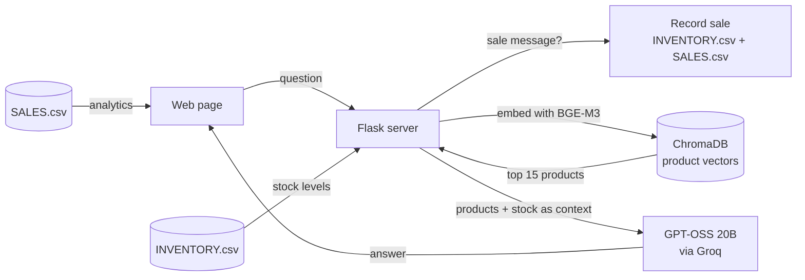

# Retail AI Assistant

An AI business assistant for a clothing store. It answers product questions using retrieval-augmented
generation (RAG) over the store's catalog, records sales from plain-language messages, and shows an
inventory and sales dashboard — all from a single web page.

## Features

### RAG product search
- Ask questions in natural language, e.g. *"Show me a black blazer for a wedding"*.
- The question is embedded with **BGE-M3** and the 15 most similar products are retrieved from **ChromaDB**.
- Each retrieved product is enriched with live stock status (`OUT OF STOCK`, `LOW STOCK`, or the exact count).
- The products are passed as context to **GPT-OSS 20B** (via Groq), which writes a short, practical answer
  and flags items that should be reordered.

### Sales recording
- Type a sale in plain language, e.g. *"2 basic blazer sold"* (Hindi phrasings such as *"2 jeans bik gaye"* also work).
- The product is matched against the catalog, stock is reduced in `INVENTORY.csv`, and the sale is appended
  to `SALES.csv` with its revenue. No LLM call is needed for this path.

### Dashboard
- **Inventory insights:** deadstock (no sales in 90 days), overstock (more than 60 days of stock left) and
  products to reorder soon (7 days or less remaining).
- **Sales & revenue:** total revenue and units, top 5 products, revenue by category and a 30-day revenue trend chart.

## How it works



## Tech Stack

| Area | Technology |
|---|---|
| Web server | Python, Flask |
| Embeddings | [BAAI/bge-m3](https://huggingface.co/BAAI/bge-m3) via `sentence-transformers` |
| Vector database | ChromaDB (persistent, local) |
| LLM | `openai/gpt-oss-20b` via the Groq API |
| Data processing | pandas |
| Front end | HTML, CSS, JavaScript, Chart.js |

## Project Structure

```
.
├── mee.py               # Flask server: page, /chat, /sales-data, /dashboard-data
├── business.py          # RAG search, AI replies, sale recording, dashboard analytics
├── index.py             # Builds the ChromaDB product index from the catalog CSVs
├── build_inventory.py   # Generates sample stock levels -> INVENTORY.csv
├── build_sales.py       # Generates 90 days of sample sales -> SALES.csv
├── templates/
│   └── index.html       # Chat UI and dashboard
├── requirements.txt
└── .gitignore
```

## Data Source

Product data comes from the
[Zara Dataset - Men and Women Clothing](https://www.kaggle.com/datasets/abhinavtyagi2708/zara-dataset-men-and-women-clothing)
on Kaggle (by abhinavtyagi2708). The dataset is not included in this repository; download it from Kaggle.
It was collected from Zara's public website and is intended for research and informational use, so please
respect Zara's terms of use and intellectual property.

Stock levels and sales history are **synthetic**: they are generated randomly by `build_inventory.py` and
`build_sales.py` for demonstration purposes.

## Setup

**Requirements:** Python 3.11+ and a free [Groq API key](https://console.groq.com/keys).

1. **Clone and install**
   ```bash
   git clone https://github.com/aryann-dev/retail-ai-assistant.git
   cd retail-ai-assistant
   python -m venv venv
   venv\Scripts\activate        # Windows  (macOS/Linux: source venv/bin/activate)
   pip install -r requirements.txt
   ```

2. **Add your API key** — create a file named `.env` in the project folder:
   ```
   GROQ_API_KEY=your-groq-api-key
   ```
   `.env` is git-ignored and must never be committed.

3. **Add the dataset** — download the Kaggle dataset and copy the CSV files from its `Men/Men/` folder into
   the project folder. The project uses these 17 files: `ACCESSORIES`, `BAGS_BACKPACKS`, `BEAUTY`, `BLAZERS`,
   `HOODIES_SWEATSHIRTS`, `JACKETS`, `JEANS`, `LINEN`, `OVERSHIRTS`, `PERFUMES`, `POLO SHIRTS`, `SHIRTS`,
   `SHOES`, `SHORTS`, `SUITS`, `SWEATERS_CARDIGANS`, `TROUSERS` (all `.csv`).

4. **Generate sample data and build the index**
   ```bash
   python build_inventory.py   # creates INVENTORY.csv
   python build_sales.py       # creates SALES.csv
   python index.py             # builds the ChromaDB index (downloads BGE-M3 on first run, a few GB)
   ```

5. **Run**
   ```bash
   python mee.py
   ```
   Open http://127.0.0.1:5000 in your browser.

## Notes

- Recording a sale through the chat **modifies** `INVENTORY.csv` and `SALES.csv`. Re-run the build scripts to reset them.
- The boutique selector on the page is a UI placeholder; all requests currently use the same catalog.
- The Flask server runs in debug mode and is intended for local use only.
